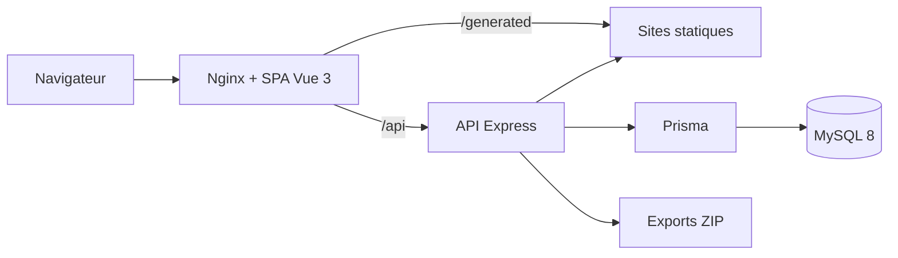

# Trame — atelier de pages

Trame est un éditeur visuel de sites one-page. Il permet de composer une page, de la prévisualiser en mobile ou desktop, puis de l’exporter sous la forme d’un site statique HTML/CSS autonome.

Le projet met en avant une application complète et exploitable : authentification, rôles, isolation des données, génération statique, export ZIP, conteneurisation et intégration continue.

## Fonctionnalités

- création à partir d’une page vierge ou d’un modèle portfolio/studio ;
- sections texte, image et hero réordonnables ;
- personnalisation du thème, du SEO, de l’en-tête, du pied de page et du fond desktop ;
- aperçu en direct aux formats mobile et desktop ;
- génération et téléchargement d’un ZIP statique prêt à héberger ;
- comptes `USER` et `ADMIN`, sessions sécurisées et protection CSRF ;
- isolation des projets par propriétaire ;
- administration des utilisateurs et réinitialisation des mots de passe ;
- migrations, volumes persistants et healthchecks avec Docker Compose.

La fonctionnalité d’envoi d’emails a volontairement été retirée. L’adresse du pied de page est uniquement une coordonnée affichée sur le site généré.

## Architecture



Le frontend suit une séparation simple entre pages, composants métier, composables d’orchestration et fonctions de domaine testables. Le backend sépare routes, contrôleurs, validation, authentification et génération statique.

```text
frontend/src/
├── components/       composants d’édition et aperçu partagé
├── composables/      authentification et orchestration de l’éditeur
├── data/             modèles de démarrage
├── pages/            écrans routés
└── utils/            slug, sections et sérialisation

backend/src/
├── auth/             sessions, mots de passe et autorisations
├── controllers/      cas d’usage HTTP
├── middleware/       protections transversales
├── routes/           déclaration de l’API
├── utils/            génération et purge
└── validators/       contrats d’entrée Zod
```

## Démarrage avec Docker

Prérequis : Docker Engine et Docker Compose v2.

```bash
cp .env.docker.example .env.docker
```

Remplacer toutes les valeurs `change-me`. Si un mot de passe contient des caractères réservés dans une URL (`@`, `:`, `/`, `%`), l’encoder dans `DATABASE_URL`.

```bash
docker compose --env-file .env.docker up -d --build
docker compose --env-file .env.docker --profile tools run --rm create-admin
```

Ouvrir [http://localhost:8080](http://localhost:8080), puis retirer `ADMIN_PASSWORD` de `.env.docker`.

Au démarrage, le backend attend MySQL puis exécute `prisma migrate deploy`. Les données et les sites générés sont conservés dans les volumes `mysql_data` et `generated_data`.

Commandes utiles :

```bash
docker compose --env-file .env.docker ps
docker compose --env-file .env.docker logs -f backend
docker compose --env-file .env.docker up -d --build
docker compose --env-file .env.docker down
```

`docker compose down` conserve les volumes. L’option `-v` les supprime et ne doit pas être utilisée sur une instance contenant des données utiles.

## Développement local

Prérequis : Node.js 20+, npm et MySQL 8.

```bash
cd backend
cp .env.example .env
npm ci
npx prisma generate
npx prisma migrate dev
npm run dev
```

Dans un second terminal :

```bash
cd frontend
npm ci
npm run dev
```

Le frontend écoute sur `http://localhost:5173` et transmet les appels API vers `http://127.0.0.1:4000`.

## Tests et qualité

```bash
cd backend
npm test
npx prisma validate
npm audit

cd ../frontend
npm test
npm run build
npm audit
```

La pipeline GitHub Actions exécute ces vérifications à chaque push sur `main` et pour chaque pull request. Elle construit ensuite la pile Docker, attend les healthchecks et vérifie le point d’entrée public. Dependabot regroupe mensuellement les mises à jour npm et GitHub Actions.

## Mise en ligne

La configuration publie Nginx sur `127.0.0.1:8080` par défaut. En production, placer un reverse proxy HTTPS devant ce port et configurer :

```dotenv
APP_ORIGIN=https://trame.example.com
CORS_ORIGINS=https://trame.example.com
COOKIE_SECURE=true
BIND_ADDRESS=127.0.0.1
APP_PORT=8080
```

Le proxy doit transmettre `Host`, `X-Forwarded-For` et `X-Forwarded-Proto`. Ne pas exposer MySQL ou l’API directement sur Internet. Prévoir le DNS, TLS et une politique de sauvegarde avant l’ouverture publique.

## Sécurité

- mots de passe dérivés avec `scrypt` et sel aléatoire, minimum 12 caractères ;
- jetons de session stockés sous forme de hash et expirant après huit heures ;
- cookies `HttpOnly`, `SameSite=Strict` et `Secure` sous HTTPS ;
- protection CSRF pour les écritures ;
- limitation des tentatives de connexion ;
- contrôle du rôle et du propriétaire sur les ressources ;
- validation stricte des données et échappement du HTML généré ;
- en-têtes de sécurité et CSP au niveau Nginx.

Sans envoi d’email, la récupération de compte reste volontairement administrée : un administrateur produit un mot de passe provisoire, que l’utilisateur change ensuite depuis l’application.

## Sauvegarde

Sauvegarder la base MySQL et le volume `generated_data`. Exemple :

```bash
docker compose --env-file .env.docker exec -T db sh -c \
  'exec mysqldump -uroot -p"$MYSQL_ROOT_PASSWORD" --single-transaction "$MYSQL_DATABASE"' \
  > trame.sql
```

Tester régulièrement la restauration sur une instance séparée.

## Limites connues et évolutions

- les images sont actuellement stockées en data URL dans la configuration JSON ; un stockage objet compatible S3 est recommandé à plus grande échelle ;
- les sites produits sont volontairement statiques et one-page ;
- la publication automatique vers un hébergeur n’est pas incluse dans ce périmètre ;
- une suite end-to-end navigateur pourra compléter les tests unitaires et le smoke test Docker.

## Licence

Distribué sous licence [MIT](LICENSE).
